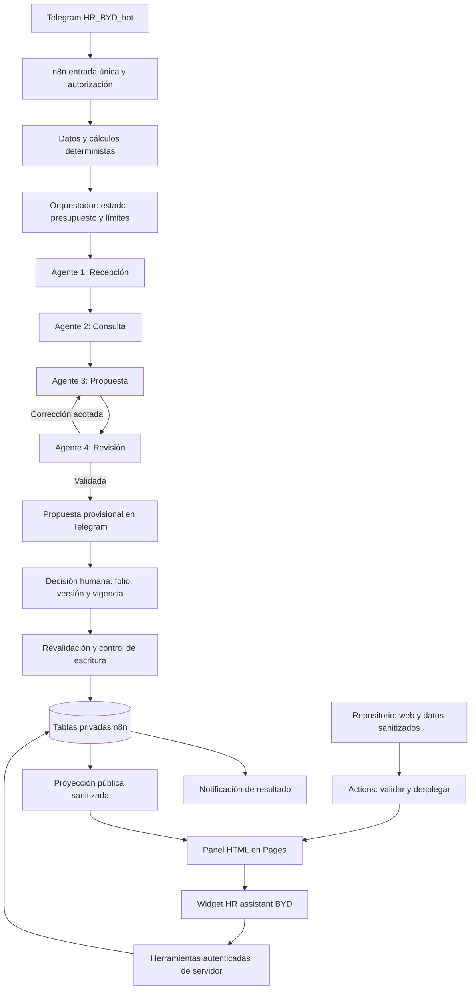

# Arquitectura de RH Vacaciones BYD
Elaborado por: Jorge Valencia. Documentación de la implementación exportada y probada; revisión: 21 de noviembre de 2026.

El sistema comparte registros entre Telegram, n8n, cuatro especialistas y ElevenLabs. Las operaciones usan quince empleados ficticios de tres equipos, sin pagos reales. El folio vincula solicitud, propuesta, decisión, reservas y llamadas; las consultas de saldo independientes conservan su consulta_id.

Actions publica el código estático; no ejecuta los agentes en cada consulta. El panel consulta la proyección de n8n al abrir, con botón manual y cada sesenta segundos mientras es visible. El respaldo estático tiene fecha y advertencia. Ese mecanismo se documenta como lectura dinámica; no como un commit de Actions por cada aprobación.

| Componente | Dónde corre | Función y límites |
|---|---|---|
| HTML/CSS/JS y widget | GitHub Pages / navegador | Interfaz y campos públicos; no claves ni base privada completa. |
| Coordinación y tablas | n8n Cloud | Autorización, consultas, cálculo, persistencia y decisiones. |
| Cuatro especialistas | GPT-5 vía subworkflow HTTP | Instrucciones y contratos diferenciados; no conceden permisos ni aprobación humana. |
| Voz y conversación | ElevenLabs | LFT informativa y herramientas de estado/saldo; no sustituye los cuatro especialistas. |
| Publicación | GitHub Actions | Ejecuta validadores y publica solo web/ tras pasar controles. |

## Contratos y recursos

Roles en [agentes/README.md](../agentes/README.md), instrucciones/contratos en [agentes/Contratos_Jorge_Valencia.json](../agentes/Contratos_Jorge_Valencia.json), esquemas en [datos](../datos/Esquema_tablas_Jorge_Valencia.json), importación en [manual](Manual_instalacion_Jorge_Valencia.md) y requisitos por nodo en [mapa](../n8n/Mapa_configuracion_Jorge_Valencia.json).

Dos skills versionados se cargan como snapshots compilados y se proyectan por rol. Su hash conecta los archivos con las trazas. El loop de calidad permite una corrección; seguridad/costo controla cada paso, máximo seis generaciones, 1,500 tokens por generación, 120 segundos y USD 0.10 por caso. La vigencia de propuesta es treinta minutos. Estas son condiciones del export, no una promesa de disponibilidad indefinida.

## Zonas de acceso

Solo datos ficticios sanitizados y registros seleccionados están en este repositorio público. Credenciales, códigos, IDs personales, tabla de accesos y conversaciones completas permanecen privados. El estado de negocio se modifica mediante n8n, no editando el JSON de respaldo del panel.

La deduplicación de entrada consulta antes de insertar: la prueba secuencial no demuestra atomicidad concurrente. La aprobación incluye control y verificación de reserva; una escritura parcial necesita conciliación. Ver [índice](../evidencias/README.md) para distinguir integración histórica, configuración y ensayos aislados.

## Operación de los servicios

Los cuatro exports corresponden a los workflows probados y confirmados por Jorge. n8n y ElevenLabs atienden solicitudes fuera de Pages y requieren una instancia disponible y cuota suficiente. Un acceso por código no prolonga la vigencia del hosting; una página estática puede abrir aunque su backend no responda.
